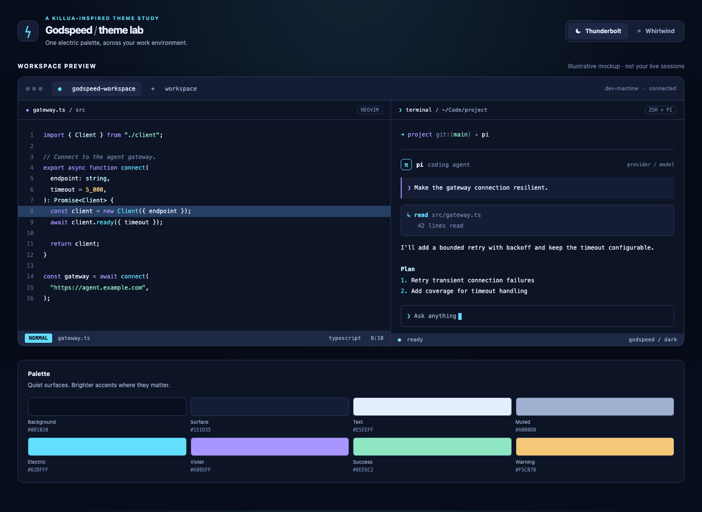
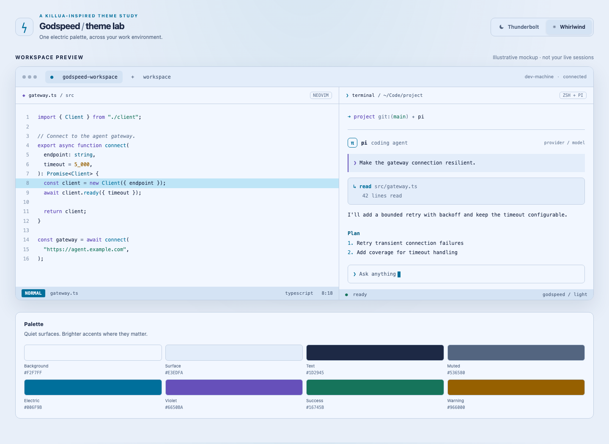

# Godspeed

A cold, electric theme inspired by Killua's Godspeed: deep blue, lightning cyan, storm violet, and a hit of green. Two variants: **Thunderbolt** (dark) and **Whirlwind** (light).

## Preview

### Thunderbolt · dark

Deep navy, electric cyan, storm violet and cool green.



### Whirlwind · light

A frosted background with deeper blue, violet and green accents.



These are illustrative mockups, not screenshots of running applications. To explore both variants interactively, clone the repo and open [`preview/index.html`](preview/index.html) in a browser.

### Palette

| Role | Thunderbolt | Whirlwind |
| --- | --- | --- |
| Background | `#0B1020` | `#F2F7FF` |
| Surface | `#151D35` | `#E3EDFA` |
| Text | `#E5EEFF` | `#1D2945` |
| Electric blue | `#62DFFF` | `#006F9B` |
| Violet | `#A995FF` | `#6650BA` |
| Green | `#8EE6C2` | `#16745B` |
| Amber | `#F5C878` | `#966000` |
| Coral | `#FF8299` | `#B93255` |

## Use

### Neovim

Add this repository to your runtime path with your plugin manager, then:

```lua
vim.cmd.colorscheme('godspeed-thunderbolt') -- or godspeed-whirlwind
-- Alternatively, :colorscheme godspeed follows vim.o.background at load time.
```

Run `:set background=light | colorscheme godspeed` or use `godspeed-whirlwind` for the light palette. `godspeed` does not automatically watch OS appearance changes.

### Pi

Install the repo as a Pi package (pin a release or commit if reproducibility matters):

```sh
pi install git:github.com/BearGuy/godspeed-theme
```

Select `godspeed-thunderbolt` or `godspeed-whirlwind` in `/settings`, or set `"theme": "godspeed-whirlwind/godspeed-thunderbolt"` in Pi's user settings for automatic terminal appearance selection. Pi uses the terminal's reported appearance; it falls back to dark when it cannot detect one.

### Terminal and zsh

`terminal/*.ghostty` are Ghostty-compatible 16-colour schemes. Select/import one using your terminal's own settings; it controls the background and ANSI colours your shell and terminal applications inherit. Switching a shell theme alone cannot change every terminal's background.

Optionally source `zsh/godspeed.zsh` **after** zsh-syntax-highlighting to colour its tokens. Set `GODSPEED_VARIANT=whirlwind` before sourcing for light mode. It exposes `GODSPEED_CYAN`, `GODSPEED_VIOLET`, `GODSPEED_GREEN`, etc., for an existing prompt, and does not replace your prompt.

### Rex

Rex's terminal block API supports per-block colours. Run inside a Rex terminal:

```sh
/path/to/godspeed-theme/rex/apply.sh thunderbolt
# or: /path/to/godspeed-theme/rex/apply.sh whirlwind BLOCK_ID
```

This changes one terminal block via `set_theme`, not all existing/future blocks or the Rex client chrome. Block ownership can affect when the change takes effect. To use a different Rex server, set the CLI's server configuration as usual. Consult your Rex client's settings for persistent terminal/client theming.

### Slack

`slack/thunderbolt.txt` and `slack/whirlwind.txt` contain experimental legacy eight-colour palettes. Current Slack versions may not accept this format; a working four-colour mapping has not yet been verified.

## Develop

`palettes/*.json` are the source of truth. Neovim reads them directly; the Pi, Ghostty, Rex, Slack and zsh assets are generated:

```sh
python3 scripts/generate.py
python3 scripts/generate.py --check
python3 -m unittest discover -s tests -v
```

Neovim and Pi should also be tested in actual terminals after visual changes. Palette contrast checks are a floor, not a guarantee for every app or syntax combination.
